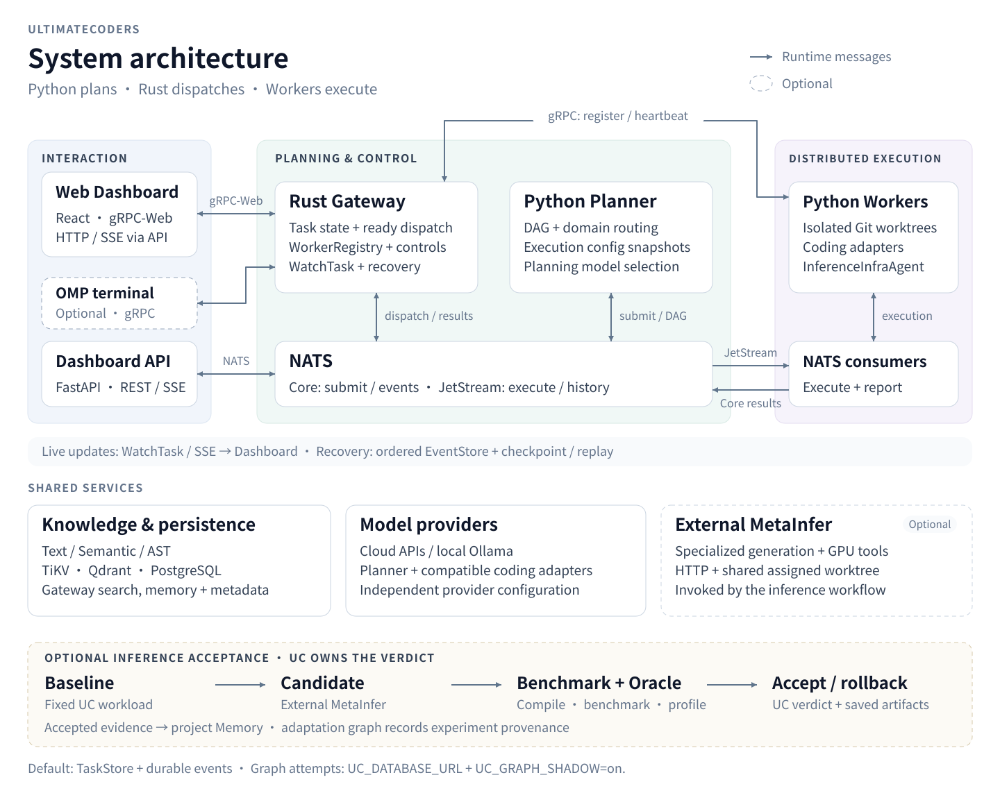

# UltimateCoders Architecture

UltimateCoders separates planning from execution authority. The Web Dashboard is the default interface, with a Dashboard API for REST/SSE and an optional native OMP extension. Python plans task DAGs and routes domains; Rust owns task controls, ready-node dispatch and the graph-backed attempt protocol. Workers execute coding adapters or inference workflows in assigned worktrees.

## System architecture

[Open the full-size diagram](screenshots/system-architecture.svg) or [the Chinese version](screenshots/system-architecture.zh-CN.svg). The three columns show entry points, planning/control, and distributed execution. Arrows represent runtime messages; dashed outlines mark optional integrations. Shared-service access is described within each card, while the lower workflow shows UC's inference acceptance boundary.

The README uses a [compact overview](screenshots/architecture-overview.svg), also available in [a mobile layout](screenshots/architecture-overview-mobile.svg). The overview summarizes responsibilities and task flow; the service diagram above shows protocol routes and acceptance boundaries.

All views are generated in English and Chinese by [the architecture generator](../scripts/generate-architecture.py), with a shared layout for each language pair. Run `python scripts/generate-architecture.py` to regenerate the six SVGs, or add `--check` to verify the checked-in outputs. The source SVGs contain selectable text and accessible descriptions; no browser scripts or remote assets are required.

## Component ownership

| Layer | Main components | Responsibility |
| --- | --- | --- |
| Interaction | React Dashboard, FastAPI Dashboard API, optional OMP | Browser gRPC-Web, REST/SSE, and terminal task entry/control |
| Planning | Python Orchestrator coordinator, optional OMP planner | Decompose/validate the DAG, select domain adapters, publish complete execution configuration |
| Control | Rust Gateway: TaskService, EngineService, DashboardService, WorkerService | TaskStore projection, ready-node scheduling, WorkerRegistry gates/placement, controls and recovery |
| Execution | NATS JetStream, Python Worker/Sandbox, coding adapters | Durable delivery, execution envelopes, isolated worktrees, progress/results |
| Acceptance | InferenceInfraAgent, MetaInferAdapter, BenchmarkRunner, Oracle, OptimizationWorkflow | Baselines, protected benchmarks, candidate acceptance/rollback and evidence |
| Knowledge | Rust hybrid index and layered Memory; TiKV, Qdrant, PostgreSQL | Text/Semantic/AST retrieval, project context, memory and structured metadata |
| Events | NATS controls/results, Gateway EventStore/broadcast, WatchTask, API SSE/metrics | Live updates, ordered history and checkpoint/replay |

The Dashboard root `/` is the product overview; `/dashboard` and `#/dashboard` are operations routes. Docker serves the UI on port 8081, the API on 8080 and gRPC/gRPC-Web on 50051. The Compose service named `orchestrator` runs the **Dashboard API**. The separate `nats-worker` service runs the **planning coordinator**; `worker` replicas use `--mode worker` for execution.

## End-to-end task flow

1. Dashboard gRPC-Web submits to TaskService, or Dashboard REST publishes through NATS. The optional OMP planner can also upsert a validated DAG through gRPC.
2. The Python coordinator consumes `uc.task.submit`, plans/validates dependencies and routes explicit inference tasks. Complete snapshots retain agent configuration, capabilities, file constraints, expected output and workflow steps.
3. The Rust Gateway receives the DAG. Default Compose sets `UC_GATEWAY_OWNS_DISPATCH=true`, so the coordinator does not also schedule these nodes locally.
4. The Gateway dispatches each pending node whose dependencies completed, subject to capability, project scope and contract-version gates. Placement defaults to file affinity; optional capacity placement ranks eligible dedicated workers by current load/capacity, retaining shared overflow.
5. Gateway-provisioned `UC_SUBTASKS` JetStream consumers deliver execution envelopes. Workers register and heartbeat through WorkerService, run the selected Sandbox adapter in a worktree, and obtain repository context through EngineService.
6. Workers publish partial results/progress over NATS. Partial updates cannot overwrite parent control status or execution configuration. A completed node can release its dependents immediately; there is no global wave completion barrier.
7. The Gateway updates TaskStore and records lifecycle events under the same lock, then broadcasts through WatchTask. The Dashboard API separately consumes NATS for SSE and metrics.
8. EventStore appends preserve recording order; checkpoint/recovery waits for earlier writes and replays the complete recorded backlog. Failed durable writes produce recovery errors. Pause/resume/cancel and late-result handling share the Gateway control boundary.

## Durable Runtime design and current activation

The design models **ExecutionGraph → Node → Attempt**, with lease renewal, worker epoch fencing, idempotency keys and commit-once terminal results. Rust controls graph transitions; Python executors report outcomes. Delivery can repeat: queue acknowledgement and stream deduplication do not by themselves provide exactly-once execution.

The startup wiring currently has two levels:

| Configuration | Active behavior |
| --- | --- |
| Default Compose: `UC_TASK_BACKEND=postgres`, `UC_EVENT_BACKEND=nats` | TaskStore serves task state; PostgreSQL stores task metadata and JetStream retains event history |
| `UC_DATABASE_URL` with storage support | Initialize PostgreSQL graph tables and perform idempotent source backfill |
| Add `UC_GRAPH_SHADOW=on` | Wire graph writes and graph-backed attempt/lease/fencing/commit operations alongside the TaskStore projection |
| Storage fallback | In-memory task/event data is transient; it does not supply a coding executor |

Default Compose supplies the database URL but does not enable graph shadow mode. Full graph-only task authority is the migration direction; it must not be inferred from database availability alone. The OMP local JSON task files are UI projection caches, with controls issued through Rust.

Ops cutover (enable / verify / rollback) is human-gated: see [the graph cutover runbook](architecture/graph-cutover-runbook.md) and dry-run `python scripts/check-graph-cutover-readiness.py`. Contract lockstep restart rules remain in [durable-runtime upgrade notes](architecture/durable-runtime-upgrade-notes.md).

The executor selector permits local fallback only for `read_only`/`local_safe` nodes with an installed local handler. Coding work needs a capable executor and queues on transport/capacity loss. The optional OMP claim loop can execute claimed nodes locally and report through Rust. A standalone Gateway without a planner/executor does not automatically perform coding tasks.

Explicit review nodes require the opt-in `review` capability and a structured JSON verdict. Shared overflow does not guarantee reviewer independence. Runtime diagnostics read persisted history and report missing measurements; they do not autonomously tune execution or implement monetary worker auctions.

## Governance plane (PR01–PR06)

A governance layer modelled on the DeepSeek Engineering Agent OS design sits **beside** the execution plane and never replaces it: `Source → Trigger → Policy → Mandate → WorkCase → Subscription → Attention` (types in `crates/uc-types/src/governance/`, durable stores in `crates/uc-engine/src/governance/`, protobuf in `crates/uc-grpc/proto/engine.proto`). It records **why** work exists and **under what authority**; `Task → DAG/Node → Attempt → Worker → EffectLedger` remains the only execution authority. An inbound trigger, an agent, a worker or a memory entry can never widen a mandate — authority originates only from a human-issued (or explicitly system-defaulted) mandate and can thereafter only be narrowed.

| Layer | Entities | Durability | Status | Documentation |
| --- | --- | --- | --- | --- |
| Governance | submission/outbox, WorkCase/CaseRun, mandate/policy, approval permits, trigger inbox, attention items, proactive proposals + watchdog decisions | namespaced JSON documents with a CAS version in one `governance_records` table (in-memory or PostgreSQL) | landed end to end: types + stores + five gRPC services (`Case` / `Trigger` / `Attention` / `Proactive` / `Approval`) + NATS JSON bridge (31 ops) + gateway boot (`crates/uc-grpc-server/src/governance_boot.rs`) + Python dashboard projections; the proto is the authoritative contract | [docs/governance](governance/README.md) |

The plane closes three loops that used to be open, each **inside** the existing execution path (no second scheduler, no rewritten DAG):

- **Event → work.** An ingested trigger deduplicates on its source identity, wakes the `waiting_event` case it belongs to, and — when the case's subscription opted into `auto_resume` and a live mandate permits `dispatch` — submits exactly one new governed run through the same submit-once path the `SubmitTask` RPC uses.
- **Stall → recovery.** The worker's progress detector raises a stall signal; the orchestrator asks the gateway watchdog (`watchdog.stall.report`) instead of deciding alone and obeys the verdict (`continue`/`retry_same_contract` keep the local ladder within the gateway's remaining budget, `replan` stops and leaves the plan to the gateway, `escalate`/`stop` stop). After a stop the proactive evaluator may propose an evidence-backed unblock, which the gateway still gates on mode, evidence and budget.
- **Human → authority.** Attention items project what needs a person; a human-tier tool (scaling workers, running containers) can be unlocked either by the operator tier or by a recorded, single-use approval (`request → decide → consume`), with the approval queue exposed at `/api/approvals` and in the dashboard's approvals view.

Capacity is read from the live worker registry (`total = Σ max_capacity`, `busy = Σ min(current_load, max_capacity)` over fresh, contract-versioned workers), so the "slots saved by quiet waiting" metric is measured rather than configured.

The dashboard projects this state over NATS request/reply (`uc.governance.request`, envelope `{"op","payload"}` → `{"ok","result"|"error"}`). When the bridge is unreachable the governance endpoints answer `503 governance_unavailable` instead of fabricating an empty state. Environment variables with their safe defaults, per-PR manual acceptance, and the upgrade order (gateway before workers, contract version lockstep) are documented in [the governance operations guide](governance/operations.md).

## Inference infrastructure and model backends

`InferenceInfraAgent` is an optional engineering domain. Workers probe live schemas and advertise only supported operation capabilities, while `inference_benchmark` remains local. The `metainfer` adapter launches the UC inference runner and delegates generation/analysis to an external service. UC retains worktree leases, operation identity, cancellation and acceptance; no MetaInfer source or GPU library enters its Worker image.

Optimization follows **fixed baseline → candidate generation/import → compile/benchmark/profile → Oracle verdict → accept or rollback**. UC owns clean assigned worktrees, protected benchmark files, Oracle policy, cancellation and rollback. MetaInfer owns specialized execution and GPU allocation; both sides must access the assigned workspace at the same absolute path. Runtime generation is not automatically optimization of an existing framework: the latter needs a suitable service plugin.

Reports, benchmark history, accepted patches and **execution/adaptation graphs** persist outside the candidate tree, in the Compose inference-artifact volume. Accepted structured evidence is published to project Memory through the Worker. This adaptation graph records experiment provenance; it is distinct from the durable execution graph that schedules nodes. Backend success alone is not correctness or performance evidence.

Planning models and coding adapters are configured independently. Ollama can supply a local OpenAI-compatible model endpoint to supported adapters; it does not replace the MetaInfer service. Local `BenchmarkRunner` measurements can run without MetaInfer. See [the inference guide](inference-infra.md) and [local verification evidence](local-deployment-verification.md) for executable examples and measured boundaries.

## Deployment modes

| Mode | Components and boundary |
| --- | --- |
| Default Compose app | Dashboard UI/API + Rust Gateway + Python planning coordinator + NATS + Worker replicas + local storage |
| Native terminal | Optional OMP planner/claim loop connected to Rust; storage and worker services depend on configuration |
| Standalone Gateway | Rust APIs with in-memory/external storage; attach a planner and executor for coding |
| Distributed workers | Gateway/coordinator plus remote Worker hosts, reachable NATS/gRPC endpoints and opt-in external Git sync |
| Inference domain | Eligible Worker + external MetaInfer, shared assigned workspace and persistent UC artifact storage |

File-overlap detection is advisory; authoritative cross-worker reconciliation happens at Git merge time. External Git push/merge is opt-in. With graph-backed arbitration, Rust grants the fenced merge barrier and Python MergeArbiter performs the merge. Worker/Gateway contract versions must align; follow the root README's deployment instructions when upgrading.

See [the README](../README.md) for runnable commands and configuration, [the runtime policy](architecture/durable-runtime-p2-policy.md) for diagnostics/review/placement boundaries, and [the migration assessment](architecture/durable-runtime-migration-assessment.md) for the original design decisions and delivery history.

## V8 alignment

UltimateCoders treats the 2026-11 V8 Agent · Decision · Inference · Training diagram as an **Agent + Decision + Evidence hardening checklist**, not as a product expansion into GPU serving or training. Inference Runtime stays MetaInfer-external; Learning OS is deferred. Ownership map, decided issues (D1–D6), and the P0 Decision Record backlog live under [docs/architecture/v8-upgrade/map.md](architecture/v8-upgrade/map.md). The ADR is [0001-v8-as-agent-decision-evidence-checklist](adr/0001-v8-as-agent-decision-evidence-checklist.md).

P0 lands an attempt-scoped Decision Record (`task:subtask:attempt` in RuntimeState namespace `decision_record`) that joins route choice, context-manifest digest/key, and terminal verdict without storing prompt content. Workers write start + terminal facts best-effort; the Dashboard exposes `GET /dashboard/api/decisions?task_id=…`. P7 adds the attempt's local effects to the same terminal block (`workspace`: changed paths + tool names, never content), derived from the git diff rather than per-tool interception (D17).

## Inference recovery boundary

The existing PostgreSQL deployment also stores Python operation/experiment records, exclusive workspace and execution claims, delivery receipts, and terminal outbox records. SQLite is a native single-host fallback only. Remote submission intent precedes HTTP creation; confirmed remote IDs are adopted on restart. Unknown submission or stop outcome quarantines the workspace and retains its backend reservation.

The validation path is now baseline → generate/import → repeated benchmark → Oracle → accepted candidate → UC commit → merge/optional push. Acceptance and delivery have separate evidence. Atomic checkpoints and manifests live outside candidate-editable files. Dashboard API artifact reads require authentication, root containment and SHA-256 verification; Compose mounts the artifact volume read-only there.

Terminal dispatch ACK follows durable outbox creation. Independent replay requests coordinator and Gateway confirmation, including durable task/event writes. Restarted coordinators read current Gateway nodes/attempts before applying a result; stale complete snapshots are fenced before mutation. These runtime records do not enable execution-graph shadow mode or change the source of Gateway scheduling authority. See [the inference guide](inference-infra.md) for configuration and operator recovery boundaries.
